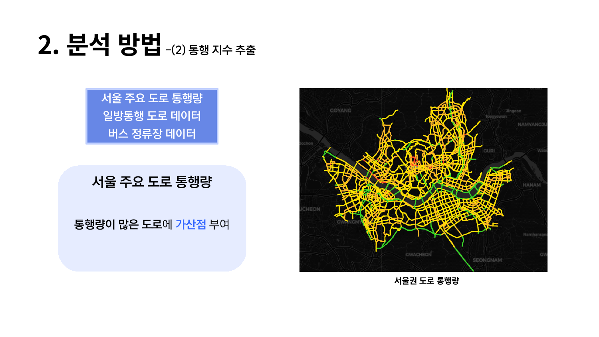
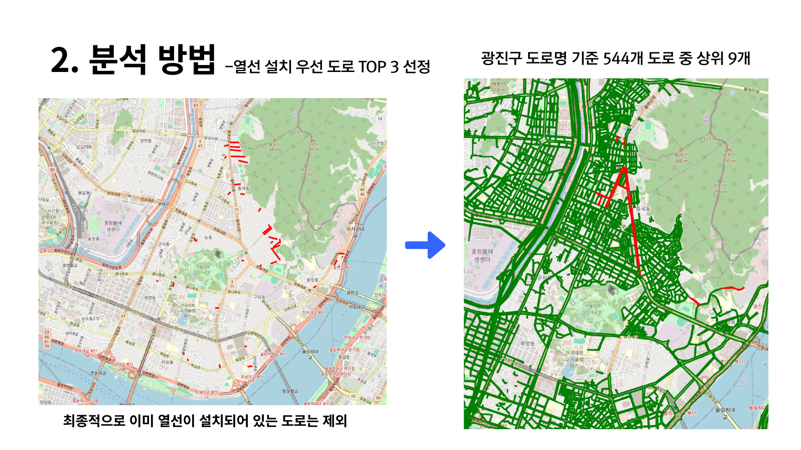
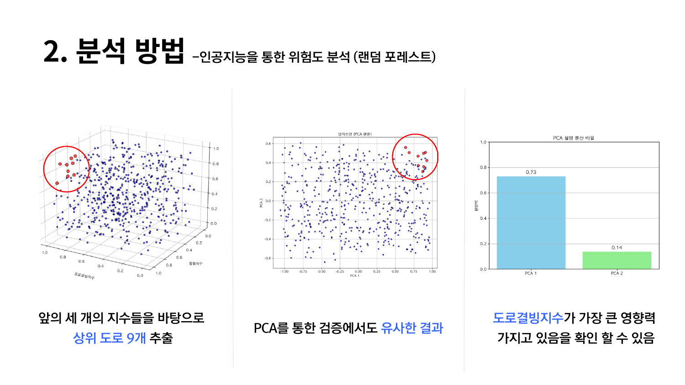

# 광진구 빅데이터 공모전

> 도로별 통행 지수를 산출해 열선 설치 우선순위 분석에 기여한 데이터분석 프로젝트

[경험 목록](../../README.md) · [분석 보고서 PDF](reports/road-heating-priority-report.pdf) · [원본 다운로드](reports/road-heating-priority-report.pdf?raw=1) · [Notion 경험 정리](https://app.notion.com/p/3c0760f4244682b2a9c381dd0c301a59?source=copy_link)

## 한눈에 보기

| 항목 | 내용 |
| --- | --- |
| 프로젝트 | 광진구 도로 결빙 예방을 위한 열선 설치 우선순위 분석 |
| 참여 | 2025년 광진구 빅데이터 분석 공모전 |
| 기간 | 2025년 상반기 |
| 팀 | TNT · 보고서 기재 참여자 3명 |
| 내 기여 | 도로 통행량·일방통행·버스정류장 데이터를 이용한 통행 지수 산출 |
| 팀 결과 | 광진구 도로명 기준 544개 도로에서 상위 후보 9개를 추려 최종 설치 후보 3곳 제안 |
| 결과물 상태 | 분석 보고서 작성. 실제 열선 설치·정책 적용 여부는 미확인 |

## 문제와 분석 목표

- **문제:** 도로 결빙에 대응할 열선 설치는 비용이 커서 설치 우선순위를 정해야 합니다.
- **목표:** 결빙 위험과 통행·안전 요소를 함께 고려해 우선 설치 후보 도로를 제안합니다.
- **분석 단위:** 광진구 도로명 기준 도로 544개

## 내가 맡은 통행 지수 산출

서울 주요 도로 통행량, 일방통행 도로, 버스정류장 데이터를 활용해 **도로별 통행 지수**를 산출했습니다.

| 입력 데이터 | 적용한 점수 방향 | 판단 근거의 성격 |
| --- | --- | --- |
| 서울 주요 도로 통행량 | 통행량이 많은 도로에 가점 | 통행 요소를 반영한 팀의 지수 설계 |
| 버스정류장 데이터 | 버스정류장이 많은 곳에 가점 | 정류장 분포를 반영한 팀의 지수 설계 |
| 일방통행 도로 데이터 | 일방통행 도로에 감점 | 양방통행 도로의 결빙 사고 위험이 더 클 수 있다는 팀의 가정 |

**입력 데이터 → 도로별 통행 지수 → 팀의 도로 결빙·안전 지수와 결합 → 설치 후보 선정**으로 이어졌습니다.

*보고서 10~12쪽에서 일방통행·통행량·버스정류장 데이터를 점수에 반영한 방향을 확인할 수 있습니다. 위 이미지는 11쪽입니다.*

## 팀 전체 분석 흐름

| 단계 | 팀이 수행한 분석 |
| --- | --- |
| 1. 데이터 수집 | 지표 온도, 경사도, 결빙·침수 위치, 통행량, 정류장, 복지시설, 사고 이력 등 수집 |
| 2. 지수 구성 | 도로 결빙 지수·통행 지수·안전 지수 구성 |
| 3. 중요도·점수 분석 | 랜덤포레스트로 지수별 중요도 분석, 종합 점수로 상위 후보 9개 도로 선정 |
| 4. 분포 확인 | PCA로 세 지수를 두 축으로 축소해 전체 도로와 후보의 분포 확인 |
| 5. 최종 제안 | 기존 열선 설치 도로를 제외하고 후보 3곳 제안 |

이 중 **제가 직접 담당한 부분은 통행 지수 산출**입니다. 랜덤포레스트·PCA와 최종 후보 선정은 팀 전체 분석으로 구분합니다.

## 기술 사용 맥락

| 도구·기법 | 프로젝트에서의 용도와 맥락 |
| --- | --- |
| Python | 팀이 바로 사용할 수 있는 언어. 서로 다른 출처의 데이터를 도로 단위로 정리하고 지수·점수 및 분석 결과를 다시 계산하는 환경 |
| QGIS | 프로젝트에서 사용한 공간정보 도구. 후보 도로의 위치·주변 환경과 도로별 분석 결과를 지도에서 확인·전달 |
| 랜덤포레스트 | 팀의 지수별 변수 중요도 분석 |
| PCA | 팀의 지수 차원 축소와 후보 도로 분포 확인 |

## 팀 결과와 근거

**544개 도로 → 상위 후보 9개 → 최종 후보 3곳**

| 우선순위 | 제안 도로 |
| --- | --- |
| 1 | 용마산로23길 |
| 2 | 영화사로20길 |
| 3 | 워커힐로93길 |

*보고서 15쪽: 전체 도로와 후보 위치, 기존 열선 설치 도로 제외 조건을 확인할 수 있습니다. 최종 3곳의 설명은 16~18쪽에 있습니다.*

<strong>PCA 결과와 해석 범위</strong>

- 보고서 그래프에 표시된 첫 두 주성분의 설명 분산 비율은 약 0.73과 0.14로, 합계 약 87%입니다.
- 이는 지수의 변동을 두 축으로 얼마나 설명하는지를 뜻하며, 예측 정확도나 정책 효과가 87%라는 뜻은 아닙니다.
- 랜덤포레스트의 학습 목표와 데이터 분할 방식은 원본 코드 확인이 필요합니다. 이 문서에서 모델 성능이나 인과 효과를 주장하지 않습니다.

## 어려움과 대응

| 구분 | 경험 |
| --- | --- |
| 어려움 | 통행 데이터를 점수로 바꿀 때 무엇을 가점·감점으로 볼지 결정하기 어려웠음 |
| 당시 대응 | 분석을 진행하기 위해 팀의 가정으로 점수 방향을 정해 지수에 적용 |
| 남은 확인 | 일방통행에 관한 가정이 광진구 사고 데이터에서도 성립하는지, 감점 크기를 바꾸면 후보 순위가 얼마나 달라지는지 확인 필요 |

## 배운 점과 다음 확인 항목

**지수 설계 자체가 분석의 중요한 의사결정이라는 점을 배웠습니다.** 같은 데이터라도 통행량의 반영 비중과 통행 방향의 점수화 방식에 따라 추천 도로가 달라질 수 있습니다.

- 최종 순위와 함께 순위에 영향을 준 가정을 설명하기
- 가점·감점 기준을 바꿔도 상위 후보가 유지되는지 비교하기
- 원본 코드에서 랜덤포레스트의 학습 목표·데이터 분할 방식을 확인하고 기록하기

위 항목은 Notion에 정리된 후속 확인 과제이며, 이미 수행한 결과로 제시하지 않습니다.

## 한계와 자료 범위

- **국지적 환경:** 그늘·바람 등 미세한 도로 환경 반영에 한계가 있습니다.
- **정적 데이터:** 과거 사고 이력과 시설 위치 중심이어서 실시간 변화 반영이 어렵습니다.
- **분석 가정:** 지수 조합과 점수 기준에 따라 후보가 달라질 수 있습니다.
- **성과 범위:** 설치 후보를 제안한 분석 결과입니다. 실제 사고 감소나 비용 절감을 측정한 결과는 없습니다.

| 근거 | 확인할 부분 |
| --- | --- |
| [보고서 PDF](reports/road-heating-priority-report.pdf) | 10~12쪽: 통행 지수 / 14~18쪽: 팀 분석 결과 / 19쪽: 한계 / 20쪽: 데이터 출처와 도구 |
| [Notion 경험 정리](https://app.notion.com/p/3c0760f4244682b2a9c381dd0c301a59?source=copy_link) | 개인 역할, 도구 사용 맥락, 점수 설계의 어려움과 배운 점. 로그인된 앱에서 열람했으며 방문자의 접근 권한은 확인하지 않음 |

보고서 원본을 이 폴더에 함께 보관했습니다. 분석 코드·원천 데이터·평가 실행 기록은 현재 이 폴더에 포함하지 않았습니다.

