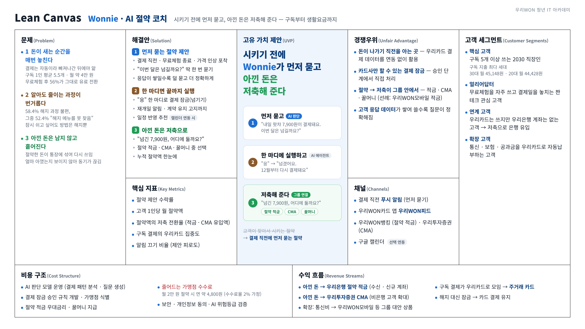
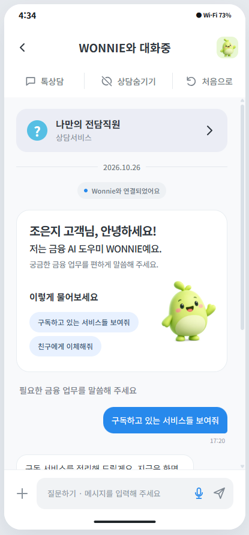
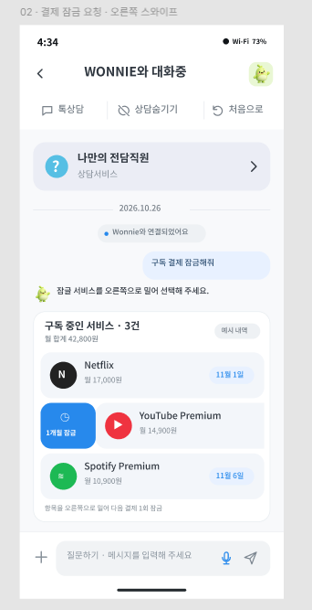
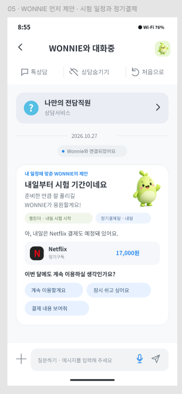

# Wonnie | 구독관리 챗봇 UI/UX와 데모 구현

**데이터분석에 관심 있는 개발 교육생**

AX 해커톤에서 **챗봇 UI/UX 설계 · 초기 데모 구현 · Wonnie 캐릭터 디자인**을 담당했습니다.

[경험 목록](../../README.md) · [팀 프로젝트 저장소](https://github.com/nakknock2/wonnie) · [데모 사이트](https://wonnie-sub-list-demo-20261026.jej41837.chatgpt.site/) · [Figma](https://www.figma.com/design/zNbbw3QqcBMbO3pwOFjG4Y/WONNIE-%EA%B8%88%EC%9C%B5-AI-%EC%B1%97%EB%B4%87-%C2%B7-%EB%AA%A8%EB%B0%94%EC%9D%BC-%ED%99%94%EB%A9%B4?node-id=0-1&p=f)

---

## 01. 대표 프로젝트 | Wonnie

> 여러 구독서비스의 이용 현황을 한눈에 확인하고, 개인별 일정과 소비 패턴에 맞는 구독 관리를 돕는 챗봇 서비스

| 항목 | 내용 |
| --- | --- |
| 프로젝트 | AX 해커톤 · 5명 팀 프로젝트 |
| 기간 | 10/26~10/28 · 2박 3일 |
| 대상 | 여러 구독서비스를 이용하며 구독내역을 정리하고 싶은 사용자 |
| 내 역할 | 챗봇 화면 설계·구현, 서비스 캐릭터 디자인 |
| 개인 구현 상태 | 실제 서비스와 연동하지 않은 초기 데모 |

### 서비스의 전체 방향

*서비스 기획 자료 · 이미지를 누르면 원본 크기로 볼 수 있습니다.*

린 캔버스에 정리된 핵심 서비스 방향은 다음과 같습니다.

| 사용자 문제 | 기획한 해결 방향 |
| --- | --- |
| 자동결제 시점을 놓치기 쉬움 | 결제 전에 먼저 묻는 절약 제안 |
| 구독을 줄이는 과정이 번거로움 | 결제 잠금으로 이어지는 간단한 대화 흐름 |
| 아낀 돈을 따로 관리하기 어려움 | 절약한 금액을 저축으로 연결 |

**먼저 제안 → 결제 잠금 → 저축 연결**은 서비스의 기획 방향입니다. 아래 개인 작업은 그중 구독 조회와 결제 잠금 흐름을 보여주는 초기 화면 데모입니다.

### 내가 구현한 데모 흐름

**구독서비스 질문 → 구독현황 표시 → 스와이프 → 다음 달 결제 1회 잠금 표현**

- **조회:** 이용 중인 서비스를 한눈에 확인하는 화면 구성
- **잠금:** 조회한 서비스를 스와이프해 결제 잠금으로 이어지는 흐름 표현
- **범위:** 실제 구독정보 조회·결제 제어 시스템 연동 없음

## 02. 화면과 캐릭터

<table>
<tr>
<th>챗봇 데모 화면</th>
<th>Wonnie 캐릭터</th>
</tr>
<tr>
<td align="center"></td>
<td align="center"></td>
</tr>
<tr>
<td>안내 화면 · 질문 입력 · 캐릭터 배치</td>
<td>화면·발표자료·영상에 활용하도록 팀에 제공</td>
</tr>
</table>

- **화면에서 확인할 부분:** ‘구독하고 있는 서비스를 보여줘’라는 입력과 Wonnie의 배치
- **캐릭터 제작 범위:** 대표 캐릭터와 상황별 표정 디자인. 이 문서에는 대표 이미지 1장 수록
- **첫 화면 캡처의 범위:** 응답 전체와 결제 잠금 과정은 보이지 않음

### Figma 설계 화면

<table>
<tr><th>구독 조회와 스와이프 잠금</th><th>일정에 맞춘 선제 제안</th></tr>
<tr>
<td align="center"></td>
<td align="center"></td>
</tr>
<tr><td>구독 목록 · 결제일 · 1개월 잠금 버튼</td><td>시험 일정 · 결제 예정 정보 · 이용 여부 선택</td></tr>
</table>

| 작업 자료 위치 | 화면에서 확인할 내용 |
| --- | --- |
| [Figma · Page 1](https://www.figma.com/design/zNbbw3QqcBMbO3pwOFjG4Y/WONNIE-%EA%B8%88%EC%9C%B5-AI-%EC%B1%97%EB%B4%87-%C2%B7-%EB%AA%A8%EB%B0%94%EC%9D%BC-%ED%99%94%EB%A9%B4?node-id=0-1&p=f)의 **02 · 결제 잠금 요청 · 오른쪽 스와이프** | 구독 목록과 스와이프 잠금의 화면 설계. 개인 담당 작업 설명과 연결되는 자료 |
| [Figma · Page 1](https://www.figma.com/design/zNbbw3QqcBMbO3pwOFjG4Y/WONNIE-%EA%B8%88%EC%9C%B5-AI-%EC%B1%97%EB%B4%87-%C2%B7-%EB%AA%A8%EB%B0%94%EC%9D%BC-%ED%99%94%EB%A9%B4?node-id=0-1&p=f)의 **05 · WONNIE 먼저 제안 · 시험 일정과 정기결제** | 일정과 결제를 연결한 서비스 제안 흐름. 전체 서비스 방향을 설명하는 자료 |

두 이미지는 **Figma 디자인 캡처**입니다. 화면에 표시된 서비스명·금액·일정은 설계 예시이며, 실제 조회·결제 처리나 테스트 성공 결과를 입증하지는 않습니다.

## 03. 개인 기여와 기술

| 담당 작업 | 직접 수행한 내용 | 사용 기술 |
| --- | --- | --- |
| 화면 설계 | 데모 시나리오를 바탕으로 화면 구성을 직접 정하고 혼자 설계 | Figma |
| 데모 구현 | 챗봇 화면과 구독 조회·스와이프 잠금 흐름을 혼자 구현 | HTML·CSS·JavaScript |
| 화면 전환 | 데모의 화면 전환 구현 | React |
| 캐릭터 제작 | Wonnie와 상황별 표정을 디자인해 팀에 제공 | — |

**팀의 서비스 기획과 제 개인 구현 범위를 구분했습니다.** 이 프로젝트에서 소개하는 제 기여는 화면 설계·초기 데모 구현과 캐릭터 제작입니다.

## 04. 어려움 → 대응 → 변화

| 단계 | 경험 |
| --- | --- |
| **어려움** | 초기 시나리오가 명확하지 않아 구현 범위를 정하기 어려웠고, 시나리오가 추가되며 화면 수정이 반복됨 |
| **대응** | 데모 시나리오가 확정된 뒤 이를 기준으로 구현 |
| **변화** | 프로토타입이 생긴 뒤 팀원 간 소통이 편해졌다고 느낌 |

소통 개선은 제가 체감한 정성적 변화이며, 별도로 측정하지 않았습니다.

## 05. 확인한 내용과 한계

| 구분 | 현재 상태 |
| --- | --- |
| 직접 확인 | 구현 과정에서 챗봇에 직접 질문하며 동작 확인 |
| 확인 기록 | 당시 질문·관찰 결과를 정리한 테스트 기록은 이 문서에 미포함 |
| 실제 연동 | 개인 데모에는 실제 구독정보 조회·결제 제어 연동 없음 |
| 사용자 검증 | 실사용자 검증 미실시 |
| 성능 | 성능 측정 미실시 |

따라서 실제 사용자의 이해도·사용 편의성과 성능 개선 효과는 평가하지 않았습니다.

<strong>근거 자료와 확인 범위 자세히 보기</strong>

링크 제공과 직접 열람·작동 확인은 구분합니다.

| 자료 | 확인 범위 |
| --- | --- |
| 포트폴리오 저장소 | [jej41837/profile](https://github.com/jej41837/profile) 접근 및 기존 README 확인 |
| 팀 프로젝트 저장소 | 주소 제공. 내부 코드와 개인 작업 파일은 미확인 |
| Figma | Page 1의 02·05 프레임 이름과 링크를 위 작업 자료 표에 연결. 전체 배치 및 두 디자인 캡처 확인. 링크 내부 직접 열람은 미확인 |
| 데모 화면 캡처 | 질문 입력과 캐릭터 배치 확인. 응답 전체·잠금 동작 확인 불가 |
| 데모 사이트 | 작성자는 구현 당시 질문하며 확인. 포트폴리오 검토 과정에서 링크의 실제 작동은 미확인 |
| 캐릭터 | 대표 이미지 1장 수록. 상황별 표정 제작·팀 제공은 본인 설명 기준 |
| 린 캔버스 | 이 문서에 기획 이미지 수록. 기획 방향 설명 자료이며, 이미지 안 수치의 원출처와 실제 구현·운영 여부는 미확인 |

린 캔버스의 통계·예상 지표와 사업 가설은 개인의 분석 결과나 검증된 성과로 기재하지 않았습니다.

## 06. 배운 점

- **구현 범위는 시나리오에서 시작한다.** 시나리오 추가로 화면 수정이 반복된 경험을 통해, 짧은 일정일수록 데모 흐름을 먼저 구체화하는 것이 중요하다는 점을 배웠습니다.
- **프로토타입은 소통을 돕는다.** 화면 구현 후 팀 소통이 편해진 경험을 통해, 프로토타입의 협업상 가치를 배웠습니다.

## 관련 링크

- [경험 목록](../../README.md)

- [Wonnie 팀 프로젝트 저장소](https://github.com/nakknock2/wonnie)
- [구독관리 챗봇 데모](https://wonnie-sub-list-demo-20261026.jej41837.chatgpt.site/)
- [Figma 화면 설계](https://www.figma.com/design/zNbbw3QqcBMbO3pwOFjG4Y/WONNIE-%EA%B8%88%EC%9C%B5-AI-%EC%B1%97%EB%B4%87-%C2%B7-%EB%AA%A8%EB%B0%94%EC%9D%BC-%ED%99%94%EB%A9%B4?node-id=0-1&p=f)

